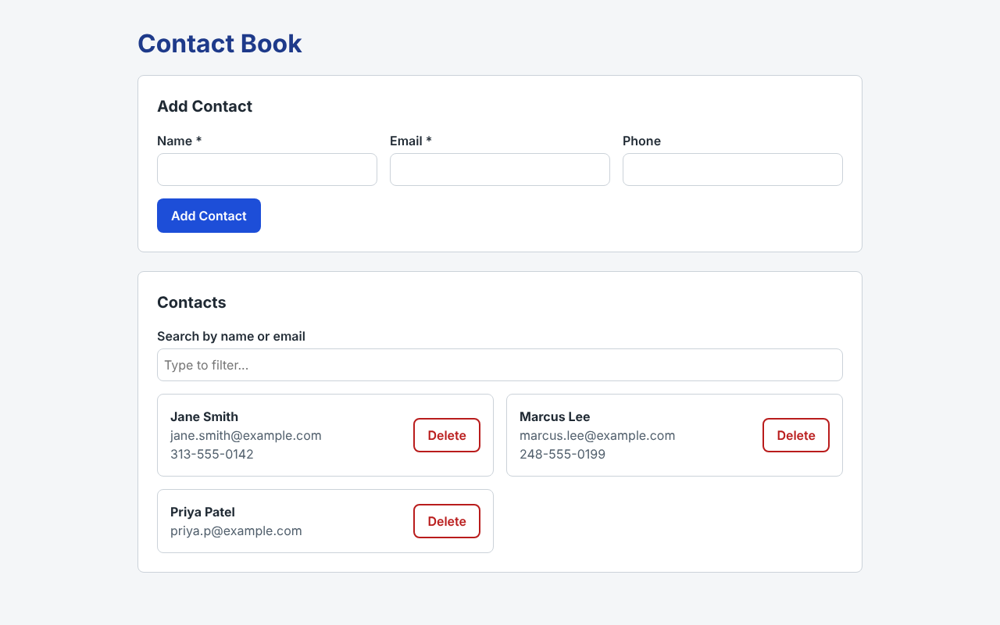
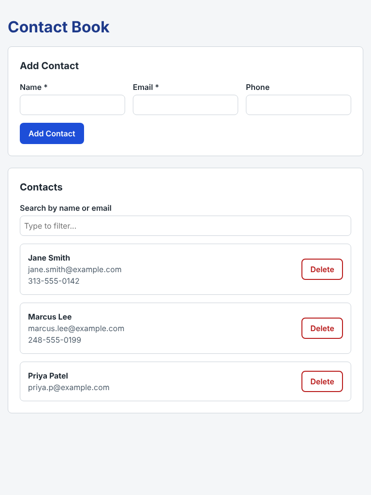
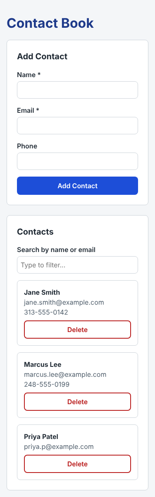

# CIS435 Fall 2026 – Project 2: Simple Contact Book

A single-page React application (built with Vite) for managing contacts in memory.

**Live site:** https://ikabir0.github.io/CIS435-Fall2026-Single-Page-React-App/

## Features

- **Add Contact** – controlled form with Name (required), Email (required, validated) and Phone (optional). Inline error messages; the form clears after a successful add.
- **List Contacts** – rendered with `map`, keyed by each contact's unique `id`.
- **Delete Contact** – each contact has a Delete button that removes it from state.
- **Search/Filter** – filters by name or email as you type (case-insensitive).
- **Conditional Rendering** – "No contacts yet. Add one above!" when empty, and "No matches found for '…'" when the search hides every contact.
- **Responsive** – stacked layout on mobile, side-by-side on tablet and desktop, with clear focus outlines on inputs and buttons.

## Component Structure

```
App            – owns contacts array and filter text (single source of truth)
├── ContactForm  – controlled Name/Email/Phone inputs, validation, submit to add
├── SearchBar    – controlled filter input
└── ContactList  – renders filtered list or empty/no-match messages
    └── ContactItem – one contact with a Delete button
```

## Run Locally

```
npm install
npm run dev
```

## Screenshots

### Desktop (1280px)


### Tablet (768px)


### Mobile (375px)

